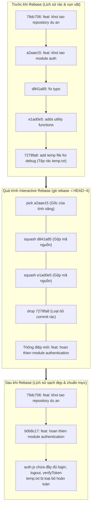

# BÀI TẬP 2: TÁI CẤU TRÚC LỊCH SỬ COMMIT BẰNG INTERACTIVE REBASE

**Mã bài tập:** SESSION 05 - EXERCISE 2 (`homework/session_05/ex2/`)  
**Môn học:** IT215 - Cloud Infrastructure & DevOps Fundamentals  
**Học viên:** Trần Đức Anh (`TranDucAnh3103`)  
**Email:** `TranDucAnh3103@users.noreply.github.com`  
**Hệ điều hành / Môi trường:** Windows 11 Single Language (26H2) / PowerShell 7+ / Git for Windows v2.47+  
**Đường dẫn thư mục dự án:** `f:/CNTT/Rikkei/IT215/ss05/ex2/`  

---

## 1. MỤC TIÊU BÀI TẬP

1. **Làm chủ công cụ tương tác Interactive Rebase (`git rebase -i`):** Chỉnh sửa, sắp xếp lại và thanh lọc lịch sử commit cục bộ trước khi đẩy (push) mã nguồn lên remote repository.
2. **Kỹ thuật gộp nhiều commit (Squash):** Hợp nhất các commit vụn vặt, sửa lỗi nhỏ lẻ (`fix typo`, `adds utility functions`) vào một commit tính năng hoàn chỉnh, giúp cây lịch sử gọn gàng, mang tính nguyên tử (Atomic Commit).
3. **Đổi tên thông điệp commit (Reword/Squash Edit):** Cập nhật commit message theo chuẩn Conventional Commits: `feat: hoan thien module authentication`.
4. **Loại bỏ commit rác thử nghiệm (Drop):** Loại bỏ hoàn toàn commit chứa tệp thử nghiệm tạm thời (`temp.txt`) mà không để lại vết tích rác trong cây lịch sử.
5. **Hiểu bản chất viết lại lịch sử (Rewriting History):** Nắm rõ cơ chế tạo commit hash mới của Git Rebase và quy tắc vàng (Golden Rule of Rebase).

---

## 2. BẢNG TỔNG HỢP TIẾN TRÌNH THỰC HIỆN & KẾT QUẢ KIỂM TRA

| STT | Commit / Thao tác | Hash ban đầu | Chỉ thị Rebase | Hash mới | Nội dung / Tác động kỹ thuật | Trạng thái |
| :---: | :--- | :---: | :---: | :---: | :--- | :---: |
| 1 | Khởi tạo repo | `79dc706` | Base | `79dc706` | Commit gốc chứa cấu trúc cơ sở dự án | **PASSED** |
| 2 | `feat: khoi tao module auth` | `a2aae15` | `pick` | Hợp nhất vào `b0b8c17` | Tạo tệp `auth.js` với hàm `login` cơ bản | **PASSED** |
| 3 | `fix typo` | `d841a85` | `squash` (hoặc `s`) | Hợp nhất vào `b0b8c17` | Bổ sung kiểm tra validate username/password | **PASSED** |
| 4 | `adds utility functions` | `e1ad0e5` | `squash` (hoặc `s`) | Hợp nhất vào `b0b8c17` | Bổ sung hàm `logout` và `verifyToken` | **PASSED** |
| 5 | `add temp file for debug` | `7278fa8` | `drop` (hoặc `d`) | *Bị xóa bỏ* | Xóa hoàn toàn commit và tệp `temp.txt` | **PASSED** |
| **KẾT QUẢ** | **Commit sau Rebase** | — | — | **`b0b8c17`** | **`feat: hoan thien module authentication`** | **PASSED** |

---

## 3. CƠ CHẾ HOẠT ĐỘNG CỦA INTERACTIVE REBASE

### 3.1. Bảng tra cứu các lệnh chỉ thị trong Interactive Rebase

| Lệnh | Viết tắt | Ý nghĩa và hành vi kỹ thuật |
| :--- | :---: | :--- |
| `pick` | `p` | Giữ nguyên commit này, áp dụng lần lượt vào nhánh mới. |
| `reword` | `r` | Giữ nguyên nội dung mã nguồn của commit nhưng dừng lại để sửa commit message. |
| `edit` | `e` | Dừng tiến trình rebase tại commit này để cho phép sửa đổi nội dung tệp tin hoặc tách nhỏ commit. |
| `squash` | `s` | **Gộp commit này vào commit ngay phía trên**, đồng thời mở trình soạn thảo để gộp và chỉnh sửa thông điệp commit. |
| `fixup` | `f` | Gộp commit này vào commit ngay phía trên tương tự `squash`, nhưng **tự động vứt bỏ** thông điệp của commit này (chỉ giữ message của commit trước). |
| `drop` | `d` | **Xóa bỏ hoàn toàn commit này**, loại bỏ mọi thay đổi của commit đó ra khỏi cây lịch sử. |

### 3.2. Sơ đồ tái cấu trúc cây commit (Before & After)



---

## 4. CHI TIẾT CÁC BƯỚC THỰC HIỆN VÀ MINH CHỨNG THỰC TẾ

### Bước 1: Khởi tạo môi trường và 4 commit thử nghiệm

Khởi tạo repository cục bộ và mô phỏng quá trình code tính năng thực tế với 4 commit:

```powershell
cd f:\CNTT\Rikkei\IT215\ss05\ex2
git init -b main
git config --local user.name "TranDucAnh3103"
git config --local user.email "TranDucAnh3103@users.noreply.github.com"
git config --local core.autocrlf false

# Commit cơ sở
"He thong quan ly nguoi dung" | Out-File -FilePath "README.md" -Encoding utf8
git add README.md
git commit -m "feat: khoi tao repository du an"

# Commit 1: Tạo auth.js ban đầu
# Commit 2: Sửa auth.js (fix typo)
# Commit 3: Bổ sung logout & verifyToken (adds utility functions)
# Commit 4: Tạo temp.txt (add temp file for debug)
```

**Lịch sử commit ban đầu (`git log --oneline`):**
```text
7278fa8 add temp file for debug
e1ad0e5 adds utility functions
d841a85 fix typo
a2aae15 feat: khoi tao module auth
79dc706 feat: khoi tao repository du an
```

Nhận xét: Nhánh đang chứa 3 commit vụn vặt về `auth` và 1 commit chứa file tạm `temp.txt` không nên đưa lên remote.

---

### Bước 2: Kích hoạt Interactive Rebase

Thực hiện lệnh tương tác lùi về 4 commit tính từ đỉnh nhánh:

```powershell
git rebase -i HEAD~4
```

> [!NOTE]
> `HEAD~4` ở đây trỏ tới commit cơ sở `79dc706`. Thao tác này hướng dẫn Git bóc tách 4 commit từ `a2aae15` đến `7278fa8` và đưa vào danh sách chỉnh sửa tương tác.

---

### Bước 3: Cấu hình bảng chỉ thị Interactive Rebase (`git-rebase-todo`)

Khi trình soạn thảo mở tệp cấu hình tạm thời của Git, danh sách commit xuất hiện theo thứ tự thời gian từ cũ nhất (trên cùng) đến mới nhất (dưới cùng):

```text
pick a2aae15 feat: khoi tao module auth
pick d841a85 fix typo
pick e1ad0e5 adds utility functions
pick 7278fa8 add temp file for debug

# Rebase 79dc706..7278fa8 onto 79dc706 (4 commands)
#
# Commands:
# p, pick <commit> = use commit
# r, reword <commit> = use commit, but edit the commit message
# e, edit <commit> = use commit, but stop for amending
# s, squash <commit> = use commit, but meld into previous commit
# f, fixup [-C | -c] <commit> = like "squash" but keep only the previous
# d, drop <commit> = remove commit
```

**Thao tác chỉnh sửa:** Đổi chỉ thị dòng 2 và dòng 3 thành `squash`, đổi dòng 4 thành `drop`:

```text
pick a2aae15 feat: khoi tao module auth
squash d841a85 fix typo
squash e1ad0e5 adds utility functions
drop 7278fa8 add temp file for debug
```

Lưu và đóng trình soạn thảo lại.

---

### Bước 4: Soạn thảo thông điệp commit sau khi gộp (`COMMIT_EDITMSG`)

Git tự động hợp nhất các tệp thay đổi từ commit 1, commit 2 và commit 3, sau đó mở cửa sổ soạn thảo thông điệp commit. 

Nội dung gộp mặc định ban đầu:
```text
# This is a combination of 3 commits.
# This is the 1st commit message:

feat: khoi tao module auth

# This is the commit message #2:

fix typo

# This is the commit message #3:

adds utility functions
```

**Thao tác chỉnh sửa:** Xóa toàn bộ nội dung cũ và thay thế bằng duy nhất một dòng thông điệp chuẩn mực theo yêu cầu:

```text
feat: hoan thien module authentication
```

Lưu và đóng trình soạn thảo. Git tiếp tục quy trình và áp dụng chỉ thị `drop` cho commit 4 (`7278fa8`).

---

### Bước 5: Kết quả thực thi từ hệ thống Git

Git hoàn tất quy trình rebase tự động:

```text
Rebasing (2/4)
Rebasing (3/4)
[detached HEAD b0b8c17] feat: hoan thien module authentication
 Date: Tue Oct 6 16:31:27 2026 +0700
 1 file changed, 19 insertions(+)
 create mode 100644 auth.js
Rebasing (4/4)
Successfully rebased and updated refs/heads/main.
```

---

### Bước 6: Kiểm tra và xác minh tính toàn vẹn (Verification)

#### 1. Kiểm tra lịch sử commit:
```powershell
git log --oneline
```
**Kết quả hiển thị:**
```text
b0b8c17 feat: hoan thien module authentication
79dc706 feat: khoi tao repository du an
```
$\rightarrow$ Lịch sử chỉ còn duy nhất một commit đại diện cho tính năng hoàn chỉnh, không còn các commit rác phụ.

#### 2. Kiểm tra sự tồn tại của tệp rác `temp.txt`:
```powershell
Test-Path temp.txt
```
**Kết quả:**
```text
False
```
$\rightarrow$ Tệp rác `temp.txt` đã biến mất hoàn toàn khỏi thư mục làm việc và kho lưu trữ.

#### 3. Kiểm tra nội dung tệp `auth.js`:
```javascript
// Authentication Module - complete
function login(username, password) {
    if (!username || !password) {
        throw new Error("Invalid credentials");
    }
    console.log("Logging in user: " + username);
    return true;
}

function logout(token) {
    console.log("User logged out with token: " + token);
    return true;
}

function verifyToken(token) {
    return token !== null && token !== undefined;
}

module.exports = { login, logout, verifyToken };
```
$\rightarrow$ Tệp chứa toàn bộ logic tích lũy từ 3 commit đã gộp: đầy đủ hàm `login`, validation, `logout`, và `verifyToken`.

---

## 5. QUY TẮC VÀNG VÀ THỰC HÀNH TỐT NHẤT VỚI REBASE (BEST PRACTICES)

> [!CAUTION]
> **The Golden Rule of Rebasing (Quy tắc vàng của Rebase):**
> *Tuyệt đối không bao giờ rebase các commit đã được push lên Remote Repository dùng chung (Shared/Public Branch)!*
> - Rebase sẽ tạo ra các SHA-1 commit hash hoàn toàn mới và thay đổi cây lịch sử.
> - Nếu bạn rebase trên nhánh mà đồng đội đang kéo về làm việc, lịch sử sẽ bị phân kỳ (diverged) và bắt buộc phải dùng `push --force`, dễ gây mất mã nguồn của người khác.
> - **Khi nào NÊN dùng Interactive Rebase?** Chỉ dùng trên các nhánh tính năng cá nhân (Local Feature Branches) ở máy trạm TRƯỚC KHI tạo Pull Request / Merge Request.
